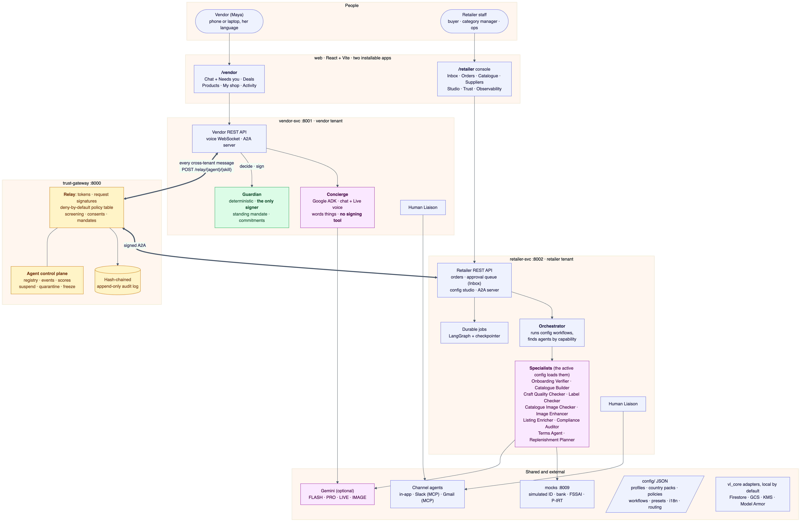
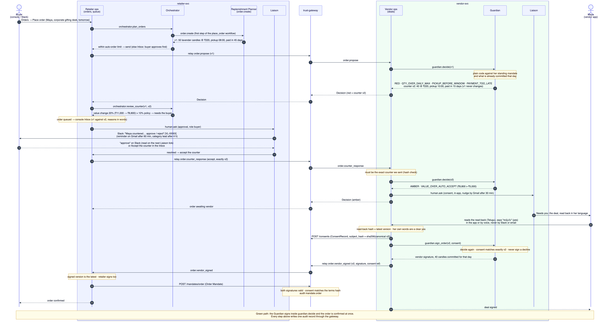

# VendorLink

**Small vendors sell to retailers in their own language, within rules they set.**

VendorLink is a multi-agent layer between small vendors (home makers, micro-brands, food
producers) and the retailers who buy from them. A vendor sets her rules once: her lowest
price, how much she can supply per day, her earliest pickup time and how fast she must be paid.
Agents then handle orders, onboarding and compliance for her. Anything inside her rules is
handled automatically; anything outside them is countered, or brought back to her to decide.

Built for the **AI Builder Cup 2026 (Retail & Commerce)**. All vendors, retailers and registries
in this repository are synthetic or simulated.

## Contents

- [Highlights](#highlights)
- [Quick start](#quick-start)
- [Prerequisites](#prerequisites)
- [Installation](#installation)
- [Configuration](#configuration)
- [Running the app](#running-the-app)
- [A five-minute tour](#a-five-minute-tour)
- [Testing](#testing)
- [Project structure](#project-structure)
- [Architecture at a glance](#architecture-at-a-glance)
- [Troubleshooting](#troubleshooting)
- [Documentation](#documentation)
- [Contributing](#contributing)
- [Status and limitations](#status-and-limitations)

## Highlights

- **Only deterministic code signs.** The Guardian checks every order against the vendor's rules
  in plain code (no LLM) and is the only agent that can sign. The chat assistant cannot.
- **Consent comes from her own words**, in the app or by voice after a read-back. Never from
  model-generated text, Slack or email.
- **A trust gateway sits between vendor and retailer.** Every message is signed, checked against
  a deny-by-default policy, screened, and written to a hash-chained audit log.
- **Configuration, not code.** Switching from *handmade gifts in India* to *packaged food in
  Indonesia* is a config switch: different language, currency, documents and agents.
- **People stay in the loop.** When an agent needs a person, it asks the right role in the app,
  on Slack or by email, then reminds and escalates.

## Quick start

```bash
git clone https://github.com/udaybhookya/VendorLink.git
cd VendorLink
make install     # Python and web dependencies
make dev         # starts everything; creates .env from .env.example on first run
```

Wait for `VendorLink ready`, then open:

| App | URL |
|---|---|
| Vendor app | <http://localhost:5173/vendor> |
| Retailer console | <http://localhost:5173/retailer> |

No API keys are needed for this. The whole order loop runs offline; AI features turn on when you
add a Gemini key ([Configuration](#configuration)).

## Prerequisites

| Tool | Version | Check | Install (macOS) |
|---|---|---|---|
| [uv](https://docs.astral.sh/uv/) | latest | `uv --version` | `brew install uv` |
| Python | 3.12 (uv installs it for you) | `uv python list` | — |
| Node.js | 20 or newer | `node --version` | `brew install node` |
| make, curl, git | any | `make --version` | preinstalled (Xcode Command Line Tools) |
| Google Chrome | any | — | only for `make ui-check` and installing the apps |

Developed on macOS; Linux works the same way. On Windows, use WSL, because the dev script is
written in bash.

## Installation

1. **Clone the repository**

   ```bash
   git clone https://github.com/udaybhookya/VendorLink.git
   cd VendorLink
   ```

2. **Install dependencies**

   ```bash
   make install
   ```

   This runs `uv sync` (Python packages into `.venv/`) and `npm install` in `web/`.

3. **Create your environment file**

   ```bash
   cp -n .env.example .env
   ```

   The defaults run everything locally with no cloud services and no keys. (`make dev` also
   creates `.env` for you if it is missing.) Never commit `.env`; it is already in `.gitignore`.

4. **Check the install** (optional, about a minute, no keys or running services needed)

   ```bash
   make check
   ```

   This runs lint, type checks and the test suite. It ends with `… passed`.

## Configuration

All settings live in `.env`. You can add capabilities in three levels; each one works on its own.

| Level | What you get | What you need |
|---|---|---|
| **A. No keys** (default) | The full order loop, the Guardian, the gateway, onboarding, both configs, observability. Slack and email messages appear in the console's **Outbox (dev)** | Nothing |
| **B. + Gemini** | The chat assistant, voice, reading product photos and labels, writing listings, AI-enhanced product photos | A Gemini API key |
| **C. + Slack and Gmail** | Questions and approvals reach real people on Slack; email reminders | A Slack app (and optionally a Google OAuth client) |

Step-by-step instructions for getting each key are in **[docs/LOCAL_SETUP.md](docs/LOCAL_SETUP.md)**.

The variables you are most likely to change:

| Variable | Default | Purpose |
|---|---|---|
| `GOOGLE_API_KEY` | empty | Gemini API key (Level B) |
| `FLASH_MODEL`, `PRO_MODEL`, `LIVE_MODEL` | empty | Model names for structured tasks, the chat assistant and voice. Empty means that feature runs without a model |
| `IMAGE_MODEL` | empty | Optional image model for AI-enhanced product photos |
| `VL_CHANNELS` | `local` | `local` sends Slack/email to the dev outbox; `mcp` sends them for real (Level C) |
| `VL_STORE`, `VL_CHECKPOINTS` | `sqlite` | `sqlite` keeps data across restarts in `.vl_data/`; `memory` forgets it |
| `ACTIVE_CONFIG` | `A` | Which preset to seed: `A` (handmade gifts, India) or `B` (packaged food, Indonesia) |
| `VL_OPERATOR_TOKEN` | local value | Token for the console's control actions (suspend, quarantine) |

Model names are never hard-coded; see [docs/LOCAL_SETUP.md](docs/LOCAL_SETUP.md#b2-pick-the-three-models)
for how to choose them. Restart `make dev` after changing `.env`.

## Running the app

### Start

```bash
make dev
```

This starts the four backend services and the web app in one terminal, seeds config A, and
prints `VendorLink ready` when everything answers. Logs from all services appear in this
terminal, one line per event. Press **Ctrl+C** to stop everything.

| Service | Port | Health check |
|---|---|---|
| Trust gateway | 8000 | `curl localhost:8000/healthz` |
| Vendor service | 8001 | `curl localhost:8001/healthz` |
| Retailer service | 8002 | `curl localhost:8002/healthz` |
| Mock registries | 8009 | `curl localhost:8009/healthz` |
| Web app | 5173 | <http://localhost:5173> |

### Demo data

| Who | Where | Notes |
|---|---|---|
| **Maya**, hand-poured candles, Hyderabad | <http://localhost:5173/vendor?vendor=vendor:maya> | Active supplier with signed rules: at least ₹180 a candle, at most 40 a day, pickup from 10:00, paid within 15 days |
| **Sara**, packaged snacks, Indonesia | <http://localhost:5173/vendor?vendor=vendor:sara> | Config B; her label is missing a P-IRT number |
| **Sam**, new supplier | <http://localhost:5173/vendor?vendor=vendor:sam> | Not onboarded yet: try **My shop** → documents → **Apply** |
| **FreshCart**, retailer | <http://localhost:5173/retailer> | The retailer console |

Product photos for trying the listing flow are in [`seed/photos/demo/`](seed/photos/demo/README.md).

### Useful commands while it runs

```bash
uv run python scripts/demo_reset.py                    # reset all data and reseed config A
uv run python scripts/demo_reset.py --scene waiting    # start a scene: work waiting on people
uv run python scripts/demo_reset.py --scene sara       # start a scene: config B, Sara's label
curl -X POST localhost:8002/dev/tick                   # process Slack/email replies and reminders now
```

You can also start straight into a scene: `DEMO_SCENE=waiting make dev`.

**Tip:** each app can be installed as its own window. In Chrome, open the URL and click the
**Install** icon in the address bar.

## A five-minute tour

Put the vendor app and the retailer console side by side.

1. **Maya → My shop:** her selling rules, signed by her Guardian with her consent.
2. **Console → Orders:** choose Maya, *Corporate gifting desk*, tomorrow, then **Place order**.
   The buyer asks for 50 candles at 08:00, paid in 45 days.
3. The Guardian answers **red** (too many, too early, paid too late) and counters with
   **40 candles at 10:00, paid in 15 days**. No model made that decision.
4. **Console → Inbox:** the counter changes the order's value by 20%, more than the retailer's
   policy accepts on its own. Click **Accept the counter**.
5. **Maya → Needs you:** the deal waits for her. Switch the 🌐 language picker to **తెలుగు** and
   tap **Yes**. The deal is **signed**.
6. **Console → Trust & audit:** **Verify** the audit chain, then **Tamper** with a record and
   verify again to see the break detected.

The full demo script, including the listing, onboarding, config-switch and attack scenes, is in
**[docs/DEMO.md](docs/DEMO.md)**.

## Testing

| Command | What it checks | Needs |
|---|---|---|
| `make check` | Lint (ruff), types (mypy) and the test suite; never calls a model | — |
| `make e2e` | The order loop: green, amber and red, ending in a signed mandate | — |
| `make attacks` | An impostor agent and an injected document are both **blocked** | — |
| `make api-check` | Every route of every service is exercised | — |
| `make web-check` | Web app type check and production build | — |
| `make ui-check` | Every screen renders in headless Chrome, phone and laptop sizes | `make dev` running |
| `make evals` | Each specialist agent's eval set (at least 8/10 each) | Models in `.env` for the AI agents |

Run `make check` before every commit. CI ([`.github/workflows/ci.yml`](.github/workflows/ci.yml))
runs the same checks on every push.

## Project structure

```
VendorLink/
├── agents/              # core agents (Guardian, Concierge, Orchestrator, Liaison), channels, specialists
├── config/              # all behaviour: profiles, country packs, policies, workflows, presets, i18n, prompts
├── docs/                # setup, demo script, architecture, plan, deploy guide, ADRs
├── infra/               # Google Cloud deployment: bootstrap, Cloud Build, Cloud Run, Firebase Hosting
├── packages/vl_core/    # shared library: schemas, config, crypto, store, LLM, A2A, observability
├── scripts/             # dev stack, demo reset and scenes, end-to-end and attack checks
├── seed/                # synthetic vendors, retailer, documents and demo photos
├── services/            # trust_gateway, vendor_svc, retailer_svc, mocks
├── tests/               # unit, contract, e2e, attack and eval suites
├── web/                 # React + Vite + TypeScript: vendor app and retailer console
├── .env.example         # every setting, with local defaults
└── Makefile             # install, dev, check and test commands
```

## Architecture at a glance



The vendor and retailer services never call each other directly; every message between them
goes through the trust gateway. A Human Liaison on each side asks people for decisions in the
app, on Slack or by email. 18 agents are configured in `config/agents.json` and called by
capability. Every cloud dependency (Firestore, Cloud Storage, KMS, Model Armor) has a local
fallback, so nothing cloud-based is needed to run it.

**The order loop**, end to end: the Guardian counters, the buyer approves the counter on Slack,
Maya says yes in Telugu, and both sides sign.



Every core flow has its own diagram, explained in
[docs/ARCHITECTURE.md → Core flows](docs/ARCHITECTURE.md#core-flows):

| Flow | Diagram |
|---|---|
| Trust gateway relay: tokens, policy, screening, audit | [02-gateway-relay](docs/diagrams/02-gateway-relay.png) |
| Selling rules and consent (voice or chat) | [03-rules-and-consent](docs/diagrams/03-rules-and-consent.png) |
| Order loop (hero order) | [04-order-loop](docs/diagrams/04-order-loop.png) |
| How the Guardian decides: green, amber, red, decline | [05-guardian-decision](docs/diagrams/05-guardian-decision.png) |
| People in the loop: ask, remind, escalate, resume | [06-human-in-the-loop](docs/diagrams/06-human-in-the-loop.png) |
| Nightly replenishment (durable LangGraph job) | [07-replenishment-job](docs/diagrams/07-replenishment-job.png) |
| Listing enrichment: photo to catalogue | [08-listing-enrichment](docs/diagrams/08-listing-enrichment.png) |
| Supplier onboarding | [09-onboarding](docs/diagrams/09-onboarding.png) |
| Config A → B switch | [10-config-switch](docs/diagrams/10-config-switch.png) |
| Attacks blocked: impostor, injected document | [11-attacks-blocked](docs/diagrams/11-attacks-blocked.png) |
| Agent registry and control plane | [12-agents-and-control-plane](docs/diagrams/12-agents-and-control-plane.png) |
| Supplier terms | [13-terms](docs/diagrams/13-terms.png) |

The diagram sources are Mermaid files next to the PNGs; run `make diagrams` after editing one.

## Troubleshooting

| Problem | Fix |
|---|---|
| `ports already in use` when starting | Another stack is running. Stop it: `lsof -tiTCP:8000-8009,5173 -sTCP:LISTEN \| xargs kill` |
| Changes to `.env` have no effect | Restart `make dev`. A variable exported in your shell overrides `.env` |
| A screen is empty after a reset | Reload the page |
| A demo scene disappeared | It was started before `VendorLink ready`; the startup reset wiped it. Run it again |
| The chat only understands simple phrases | No model is configured; it runs in offline mode. Add a Gemini key (Level B) |
| Nothing arrives in Slack | Check `VL_CHANNELS=mcp` and `uv run python -m agents mcp-tools SLACK`, then `curl -X POST localhost:8002/dev/tick` |
| Want a completely fresh start | Stop `make dev`, delete `.vl_data/`, start again |

More fixes, including Gemini, Slack and Gmail errors, are in
[docs/LOCAL_SETUP.md](docs/LOCAL_SETUP.md#5-troubleshooting).

## Documentation

| Document | Read it for |
|---|---|
| [docs/LOCAL_SETUP.md](docs/LOCAL_SETUP.md) | Getting Gemini, Slack and Gmail keys; full local setup, logs and troubleshooting |
| [docs/DEMO.md](docs/DEMO.md) | The demo script, scene by scene |
| [docs/ARCHITECTURE.md](docs/ARCHITECTURE.md) | Design principles, services, agents, a diagram of every core flow, cloud adapters, extending |
| [docs/diagrams/](docs/diagrams/) | Architecture and sequence diagrams (PNG + Mermaid source) |
| [docs/PLAN.md](docs/PLAN.md) | Modules, data model and build plan |
| [docs/adr/](docs/adr/) | Architecture decision records |
| [agents/README.md](agents/README.md) | How agents work and how to add one |
| [docs/DEPLOY.md](docs/DEPLOY.md) | Deploying the hosted demo: Cloud Run, Firestore, KMS, Model Armor, Firebase Hosting (optional) |
| [docs/solution_approach_v1.docx](docs/solution_approach_v1.docx) | The solution approach: problem, design and why |
| [docs/VendorLink_Evaluation_Report.xlsx](docs/VendorLink_Evaluation_Report.xlsx) | Evaluation report |
| [CLAUDE.md](CLAUDE.md) | Project rules and code conventions |

## Contributing

1. Create a branch from `main`.
2. Follow the rules in [CLAUDE.md](CLAUDE.md). In particular: behaviour goes in `config/`, not
   code; vendor and retailer services only talk through the gateway; only the Guardian signs.
3. Add tests with your change. New specialist agents also need an eval set.
4. Run `make check` (and `make e2e` and `make attacks` if you touched the gateway, Guardian or
   orchestrator).
5. Open a pull request.

## Status and limitations

This is a competition prototype, and some parts are deliberately limited:

- Registries, payments and logistics are simulated, and the UI says so.
- The Gmail channel only sends; replies come through the app or Slack.
- Cloud adapters (Firestore, Cloud Storage, KMS, Model Armor) are implemented and tested. The same
  code runs locally with no cloud services, or hosted on Cloud Run ([docs/DEPLOY.md](docs/DEPLOY.md)).
- Not in scope: WhatsApp or phone channels, real registry integrations, payments, routing and
  analytics.
