# VendorLink architecture

How VendorLink is built and why. For setup and running, see the [README](../README.md); for the
detailed module plan, [PLAN.md](PLAN.md); for individual decisions, [adr/](adr/).

Vendor and retailer each have their own service and agents. The only path between them is the
trust gateway. The Guardian (green) is the only signer; the agents that call models (purple) can
draft and word things but never decide. The [core flows](#core-flows) below show each feature
step by step.

## Design principles

- **A deterministic Guardian is the only signer.** The Guardian checks every order against the
  vendor's mandate with plain code, not an LLM. It returns `green` (within rules), `amber` (needs
  her OK), `red` (outside rules, so it counters) or `decline`. The conversational agent (the
  Concierge) cannot sign anything.
- **Consent comes from her own words.** Anything outside the mandate needs the vendor's own
  "yes", given in the app or by voice after a read-back. Consent is never taken from
  model-generated text, Slack or email.
- **A trust gateway sits between the two sides.** Vendor and retailer services never call each
  other. Every cross-tenant message goes through a deny-by-default gateway that checks a signed
  request, a policy table and content screening, then writes a hash-chained audit record.
- **Configuration, not code.** Business type, retailer type, country, language, thresholds and
  which specialist agents load all come from JSON in `config/`. Switching from config A to
  config B changes the whole product without a code change:

  | | Config A | Config B |
  |---|---|---|
  | Business | Handmade gifts (candles, home décor) | Packaged food |
  | Country | India (INR) | Indonesia (P-IRT, halal, IDR) |
  | Languages | English, Telugu | English, Bahasa Indonesia |
  | Retailer | Gifting buyer | Grocery chain |
  | Specialists | Craft Quality Checker, Ordering (`order.create`) | Label & Food-Safety Checker, Supplier Compliance Auditor, Replenishment (`order.replenish`) |

- **People stay in the loop.** When an agent needs a person, the Human Liaison sends the
  question to the right role in the app, on Slack or by Gmail (over MCP), then sends reminders,
  escalates and expires the request as configured.
- **Text first, voice optional.** The vendor app opens in English with a chat assistant. Voice
  and the local languages are one tap away.

## Services

| Deployable | Port | What it hosts |
|---|---|---|
| `trust-gateway` | 8000 | Tokens, request signatures, policy, screening, mandate store, hash-chained audit, containment, and the agent control plane (registry, events, observability, scores) |
| `vendor-svc` | 8001 | The Guardian and Concierge agents; vendor REST API, voice WebSocket bridge, A2A server |
| `retailer-svc` | 8002 | The Orchestrator, specialist agents and Human Liaison; orders, approval queue, config studio, retailer REST API |
| `mocks` | 8009 | Simulated ID, bank, FSSAI and P-IRT registries, demand feed, receiving |
| `web` | 5173 | Two installable apps: `/vendor` (chat-first: Chat with Needs you is home; Deals, Products, My shop, Activity) and `/retailer` (operations console: an Inbox of decisions with full context; observability under Admin) |

## Agents

There are 17 agents. They are found and called by capability through `AgentRegistry`, never
imported directly. The list and settings are in `config/agents.json`; how to write one is in
[agents/README.md](../agents/README.md).

- **Core:** Guardian, Concierge (Google ADK), Orchestrator, Human Liaison
- **Channels:** in-app, Slack (MCP), Gmail (MCP)
- **Specialists:** Catalogue Builder, Craft Quality Checker, Catalogue Image Checker, Image
  Enhancer, Listing Enricher, Produce Grader (spare, in no preset), Label Checker, Onboarding
  Verifier, Compliance Auditor, Replenishment Planner, Terms Agent

Eight agents call an AI model: the Concierge, Catalogue Builder, Craft Quality Checker,
Catalogue Image Checker, Image Enhancer (plus an image model), Listing Enricher, Produce Grader
and Label Checker. Every decision that matters (signing, approving on her behalf, policy,
blocking, audit) is deterministic code.

## Listing enrichment

When a vendor's photo or description misses the retailer's catalogue standards
(`catalogue_standards` in the retailer profile), the retailer's agents prepare an auto-enhanced
version and AI-regenerated versions (two in config A, set by
`catalogue_standards.image.candidates`) of *her own* photo, plus catalogue copy written from
*her own* facts, each fact tagged with where it came from.

Her Guardian approves the result on her behalf when it stays within her listing rules;
otherwise she picks the photo in the app. The retailer re-checks whichever photo she picks, then
publishes it, or a category manager reviews it on Slack; her side is told either way. Published
products appear in the console's **Catalogue** with their photos, copy, history and orders.
See [ADR 0008](adr/0008-listing-enrichment.md), [ADR 0009](adr/0009-catalogue-and-photo-pipeline.md)
and [ADR 0012](adr/0012-styled-looks-for-ai-photos.md).

## Core flows

Each diagram below is drawn from the code paths named in its caption. Sequence diagrams read top
to bottom: each vertical line is a participant, each arrow a call (solid) or a reply (dashed).
The sources are Mermaid files in [diagrams/](diagrams/); after changing one, run
`make diagrams` to regenerate the PNGs.

### 1. Every cross-tenant call goes through the trust gateway

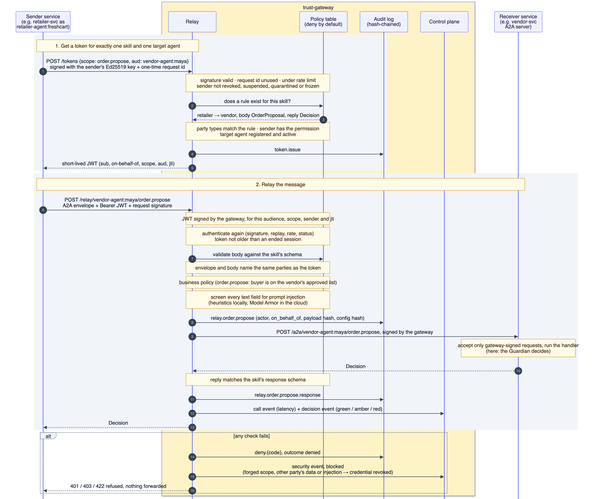

The sender first gets a token for exactly one skill and one target agent, then relays the
message. The gateway checks the request signature, replay, rate limit, agent status, the
deny-by-default policy table, the parties named in the body, business policy and content
screening. It writes an audit record before forwarding and after the reply. Any failed check is
refused, audited and raised as a security event. Code: `services/trust_gateway/gateway.py`,
`policy.py`.

### 2. Selling rules and consent

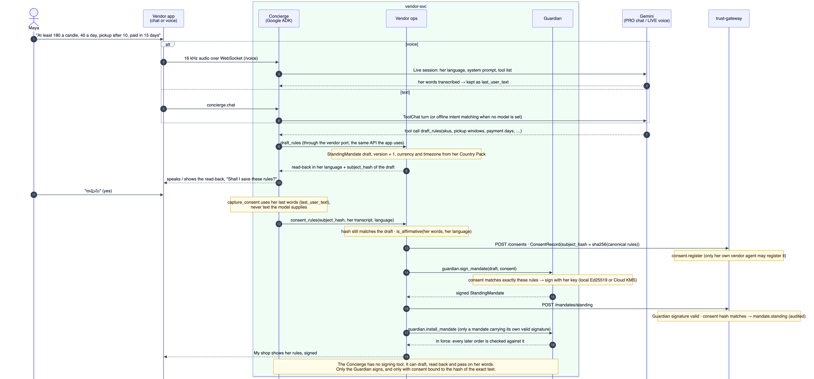

Maya says her rules by voice or in chat. The Concierge drafts them and reads them back in her
language. Her "yes" is taken from her own transcribed words, never from model output. The consent
is bound to the hash of the exact rules. The Guardian signs the standing mandate, the gateway
verifies and files it, and only then is it put in force. Code: `vendor_svc/operations.py`
(`consent_to_rules`), `agents/core/concierge/tools.py` (`capture_consent`),
`agents/core/guardian/agent.py`.

### 3. The order loop (hero order)

The retailer's ordering agent proposes 50 candles at 08:00, paid in 45 days. Maya's Guardian
answers red and counters with 40 at 10:00, paid in 15 days, as a new version. The counter changes
the order value by 20%, more than the retailer's 10% policy, so the buyer is asked on Slack.
After the buyer accepts, the Guardian rates the counter amber (over Maya's auto-accept value), so
Maya is asked in her app. Her "yes" lets the Guardian sign, and both signatures become an Order
Mandate at the gateway. Code: `retailer_svc/operations.py`, `vendor_svc/operations.py`;
checked by `scripts/e2e_order_loop.py`.

### 4. How the Guardian decides

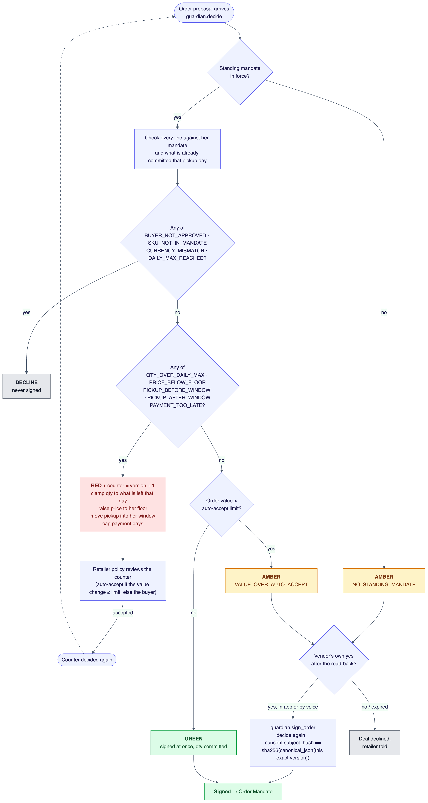

The decision is plain code with machine reason codes. A decline is never signed. Red produces the
closest proposal inside her mandate. Amber and red are signed only with consent whose
`subject_hash` equals `sha256(canonical_json(proposal))`. Code: `agents/core/guardian/rules.py`.

### 5. People in the loop

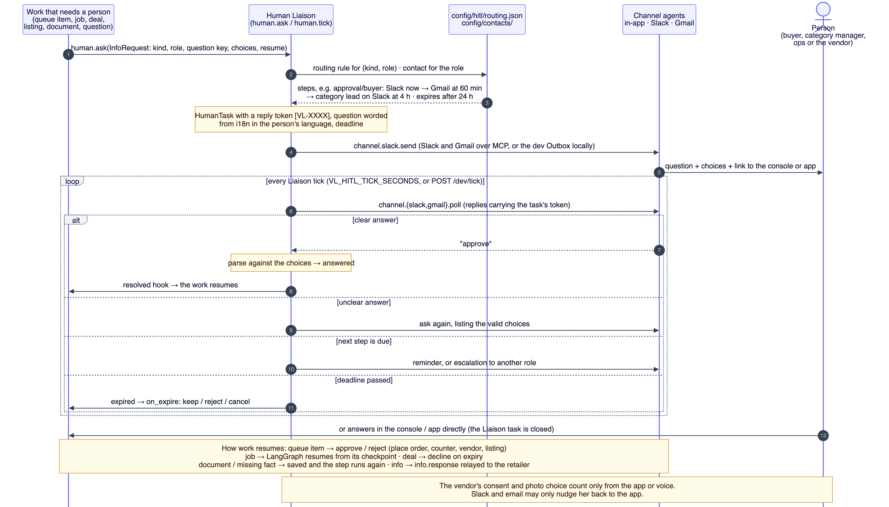

Any agent or job that needs a person asks the Human Liaison. `config/hitl/routing.json` decides
who is asked, on which channel, and when to remind, escalate or expire the question. Replies on
Slack or Gmail carry a task token, and a clear answer resumes the waiting work. Vendor consent
and photo choices count only from the app. Code: `agents/core/liaison/agent.py`,
`*/hitl.py`.

### 6. Nightly replenishment as a durable job

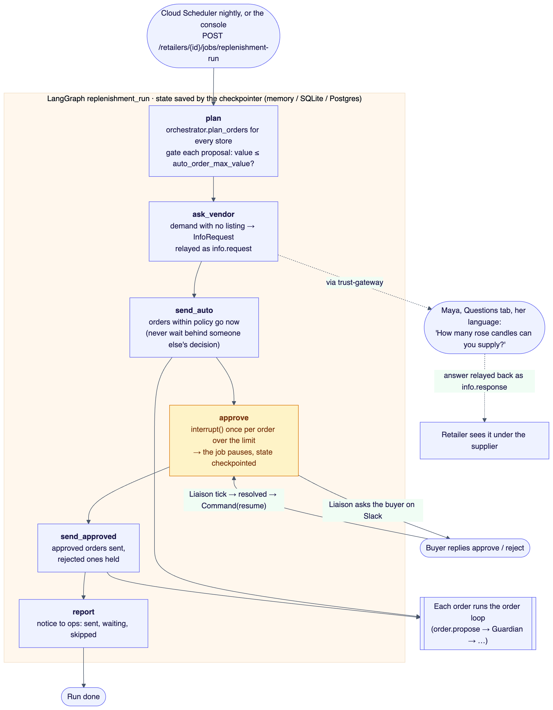

A LangGraph job plans every store and asks the vendor about demand she has no listing for. It
sends orders within policy at once and pauses with `interrupt()` on each order over the limit. It
resumes from its checkpoint when the buyer answers, even after a restart. Code:
`retailer_svc/jobs.py`.

### 7. Listing enrichment

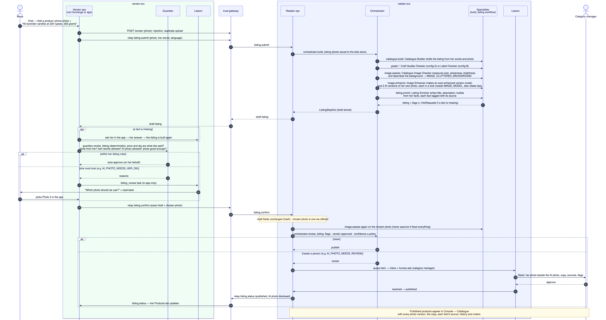

A phone photo and a sentence become a catalogue listing. The workflow from the active config
builds the draft, grades it, assesses the photo, creates enhanced and AI versions of her own
photo, and writes copy from her facts. Her Guardian approves it within her listing rules;
otherwise she picks the photo in the app. The retailer re-checks the chosen photo and publishes
it, or a category manager reviews it on Slack.

### 8. Supplier onboarding

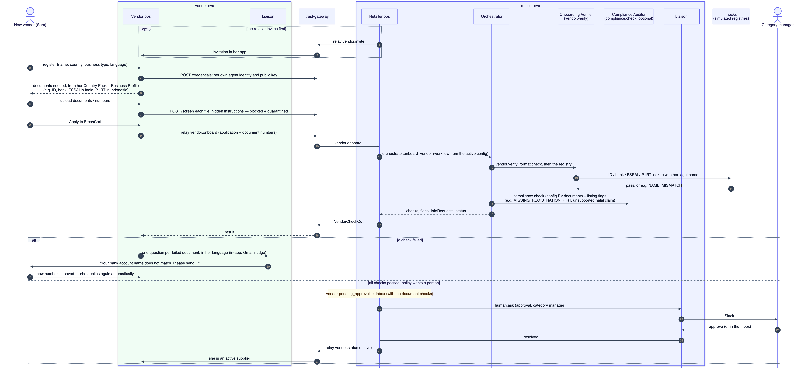

A new vendor registers, which gives her own agent identity at the gateway, and uploads the
documents her Country Pack and Business Profile require. Each file is screened before it is
stored. Applying runs the onboarding workflow: registry checks against the simulated registries,
plus compliance checks in config B. A failed check becomes a question to her in her language. A
pass goes to the retailer's Inbox for approval.

### 9. Switching market by configuration

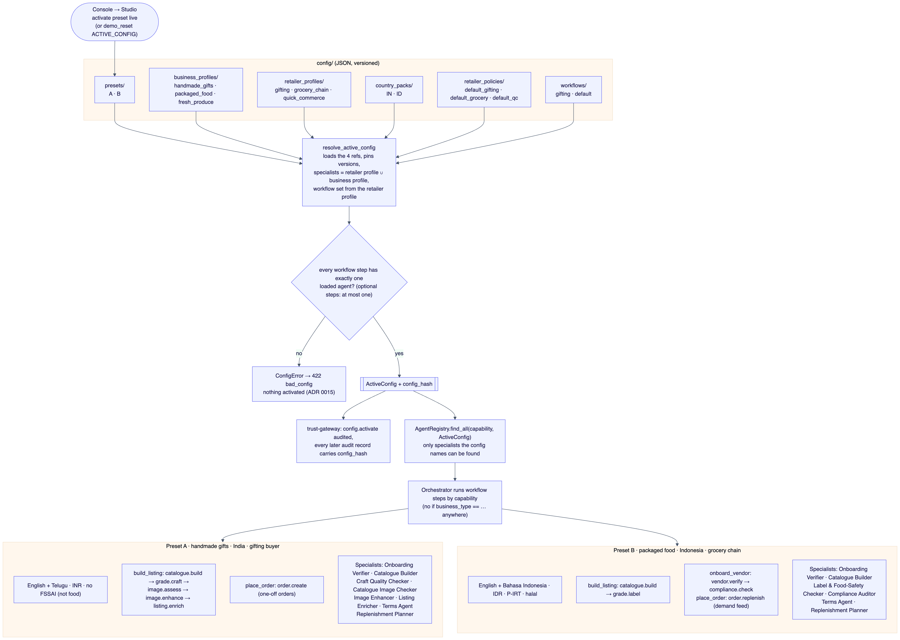

A preset names four config files. Resolving them produces an `ActiveConfig` with a hash that the
gateway records. A config whose loaded agents cannot run one of its workflow steps is refused at
this point ([ADR 0015](adr/0015-workflows-checked-at-activation.md)). The registry only finds
specialists the config names, and the Orchestrator runs workflow steps by capability, so A and B
differ without any code branch.

### 10. Attacks that must be blocked

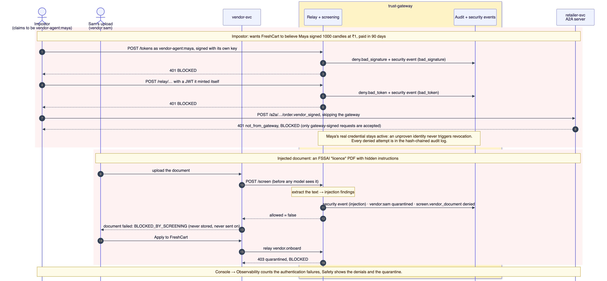

An impostor without Maya's key is refused at every path, and Maya's real credential stays active.
A document with hidden instructions is caught in screening before any model reads it, and the
uploader is quarantined. Checked by `scripts/attack_impostor.py` and
`scripts/attack_injected_doc.py`.

### 11. Agents and the control plane

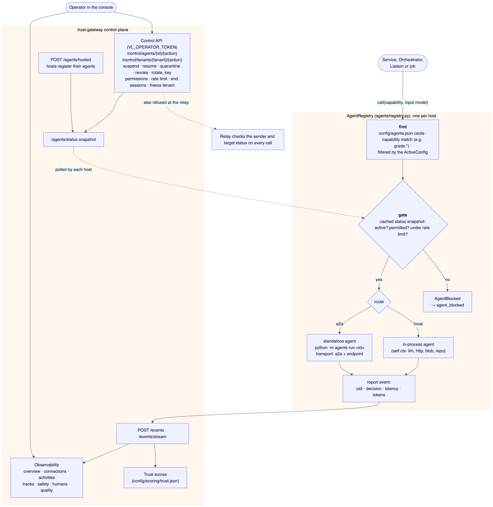

Agents are always called by capability. Before every call the registry checks a cached status
snapshot from the gateway, so a suspended or quarantined agent is refused. Every call reports an
event that feeds observability and trust scores.

### 12. Supplier terms

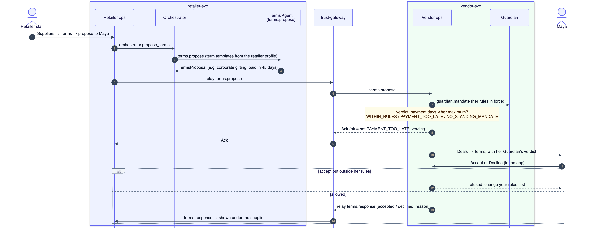

The retailer's Terms Agent proposes terms. Maya's side checks them against her rules, and she
accepts or declines in the app. She cannot accept terms outside her rules without changing her
rules first.

## Shared library and cloud adapters

`packages/vl_core` holds the schemas, config resolver, capability matching, crypto, storage, LLM
wrapper, A2A client, checkpoints and observability. Every cloud dependency sits behind a
`vl_core` interface with a local fallback:

| Concern | Local (default) | Google Cloud |
|---|---|---|
| Store | `memory` / `sqlite` | Firestore |
| Files | local disk | Cloud Storage |
| Signing | local Ed25519 keys | Cloud KMS |
| Screening | heuristics | Model Armor |

Deploying to Cloud Run is described in [DEPLOY.md](DEPLOY.md).

## Extending it

- **New business type, country or retailer type:** add config files only (see
  [PLAN.md](PLAN.md) §4), then run `make check`.
- **New specialist agent:** run
  `uv run python -m agents new <id> --capability <cap> --input <Model> --output <Model>`, enable
  it in `config/agents.json` and add an eval set. The Orchestrator and core agents do not change.
- **New gateway skill:** add a policy entry and an audit action, plus a negative test showing an
  unauthorised caller is blocked.

The full set of project rules is in [CLAUDE.md](../CLAUDE.md).
